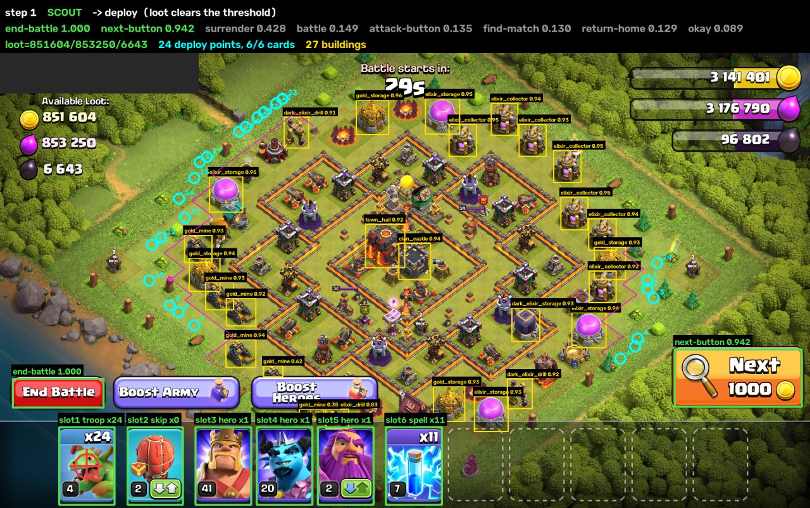

# Clash of Clans Attack Bot

A computer-vision bot that farms loot in Clash of Clans by itself. It watches the game through
screenshots, decides what to do, and taps the screen. There is no game API and no injected code:
pixels in, touches out, against the real game running in an Android emulator on macOS.



*One frame as the bot sees it: the screen it recognised and its decision (top), the loot it read,
the loot buildings it detected (yellow), where it will drop troops (cyan), and the army cards it
found (green).*

## What it does

1. **Finds its way around.** It recognises each screen from its buttons and walks from the home
   village to a battle and back.
2. **Reads the loot.** It reads an opponent's gold, elixir and dark elixir off the screen, digit by
   digit, and skips bases that hold too little.
3. **Attacks.** It finds the edge of the area where troops may be dropped, spreads the whole army
   around it, and fires the hero abilities.
4. **Knows when to leave.** It ends the battle at the first star instead of waiting out the clock.
5. **Keeps records.** Every base, battle and decision is logged, with frames, so a rule can be
   tested on past battles before it is tried live.

## Results

| | |
|---|---|
| **Ending at the first star** | **about +45% loot per hour** (41.9 vs 29.2 million per hour), measured live over 84 battles with each battle assigned its rule at random |
| Replay check | +42%, replaying the star rule on the same night's stall-arm battles (prediction fixed beforehand: +50–65%) |
| Loot threshold | about +20% more, estimated by replay; not yet measured live |
| Building detector | finds 98.7% of loot buildings on unseen bases (YOLO, trained on 276 hand-checked frames) |
| Reading numbers | exact on every saved frame, with no OCR library |
| Speed | 3.6 decisions per second, end to end |
| Tests | 260, running the whole bot against saved frames with no emulator |

Two things the data ruled out, which mattered as much as what it confirmed: a learned
"is this base worth attacking" model could add only 3–8% over a single loot threshold even if it
were perfect, so it was not built; and the old habit of waiting for loot to stop arriving wasted
more than half of every battle.

## Quick start

```bash
python3 -m venv .venv
.venv/bin/python -m pip install -r requirements.txt
```

Start BlueStacks with Clash of Clans open at **1920×1080, landscape**, then:

```bash
adb connect 127.0.0.1:5555
```

```bash
.venv/bin/python main.py --dry-run    # name the screen it sees, tap nothing
```

```bash
.venv/bin/python main.py --show       # run, with a live window of what it sees and decides
```

Stop with Ctrl-C, or `q` in the window.

## Settings

All settings are constants in the code, not flags.

| Setting | Where | Meaning |
|---|---|---|
| `DECK` | `main.py` | Your army, card by card from the left. The bot stops if the deck on screen has a different number of cards. |
| `ITERATIONS` | `main.py` | Battles per run. |
| `MIN_TOTAL` | `policy/thresholds.py` | Gold + elixir a base must show to be attacked (1.5 million). |
| `ARMS` | `policy/navigator.py` | When to end a battle: `(STAR,)` at the first star, `(FULL,)` to watch whole battles. |

## Tests

```bash
.venv/bin/python -m pytest -q
```

About 85 seconds, no emulator needed. Saved frames are local data and not in this repository, so
on a fresh clone the tests that need them are skipped.

## Layout

```
main.py     the loop and its settings
capture/    screenshots over ADB
vision/     image analysis: buttons, screens, numbers, deploy zone, cards, buildings
policy/     decisions: what to do on each screen, which bases to attack, when to end a battle
control/    taps
tools/      scripts for recording frames, cutting templates and training the detector
tests/      the test suite
templates/  button and digit templates
models/     the building detector
```
